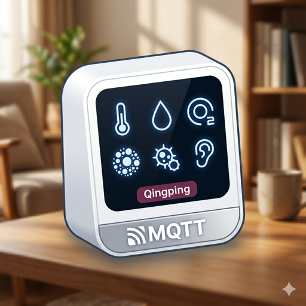

  

<h1 align="center">Qingping Air Monitor CGS2 Integration for Home Assistant</h1>

  
  
  

Локальная интеграция для **Home Assistant**, созданная специально для монитора качества воздуха **Qingping Air Monitor (CGS2)**. Работает полностью локально через **MQTT** без использования облака.

Эта интеграция разработана как максимально лёгкая и стабильная альтернатива универсальным комбайнам. Она создана исключительно для модели **CGS2**, что исключает лишний код, ошибки парсинга и задержки. Полностью совместима с **Home Assistant 2026.11+**.

## ✨ Главные особенности

* ☁️ **Local Push:** Полностью локальная работа через MQTT. Отсутствие задержек и зависимости от внешних серверов.
* 📊 **Умная работа с историей (Пакет Type 17):** Монитор при работе от батареи может копить показания и раз в 15 минут отправлять пачку исторических данных. Вы можете включить опцию **«Импортировать историю в статистику HA»** в настройках интеграции, чтобы напрямую записывать накопленные точки в долгосрочную статистику Home Assistant (`Recorder`).
* 🔋 **Точные статусы питания:** Встроенная защита от «прыгающих» статусов зарядки. Отдельные сенсоры для **«Режима питания»** (`От сети` / `От батареи`) и бинарного сенсора **«Зарядка»**.
* 🎨 **Нативные иконки и брендинг:** Встроенные иконки интеграции (`brand/`) и индивидуальные иконки для каждого датчика и состояния (`icons.json`).
* 🌍 **Мультиязычность (i18n):** Интерфейс и названия всех датчиков автоматически подстраиваются под язык вашей системы Home Assistant (поддерживаются **Русский** и **Английский**).
* ⚙️ **Простая настройка (UI):** Никакого YAML. Настройка в 2 клика через интерфейс Home Assistant.

  

## 📦 Установка

### Вариант 1: Через Marketplace (HA 2026.11+) или HACS (Рекомендуется)

1. Откройте **Настройки -> Магазин (Marketplace)** (в Home Assistant 2026.11+) или **HACS** в вашем Home Assistant.
2. Нажмите на три точки в правом верхнем углу -> **Пользовательские репозитории** (*Custom repositories*).
3. Вставьте ссылку на этот репозиторий: `https://github.com/Eugen417/HA-Qingping-AirMonitor-2`
4. Выберите категорию **Интеграция** (*Integration*) и нажмите **Добавить**.
5. Найдите `Qingping Air Monitor CGS2` в списке и установите.
6. Перезагрузите Home Assistant.

### Вариант 2: Ручная установка
1. Скачайте этот репозиторий (ZIP-архив).
2. Распакуйте папку `custom_components/qingping_cgs2` в папку `custom_components/` вашего Home Assistant.
3. Перезагрузите Home Assistant.

## 🛠 Настройка (Configuration)

**Требование:** Ваш монитор Qingping должен быть подключён к Wi-Fi и настроен на отправку данных на MQTT-брокер вашего Home Assistant (например, Mosquitto) в топики `qingping/<MAC>/up` и `qingping/<MAC>/down`.

1. Перейдите в **Настройки -> Устройства и службы -> Добавить интеграцию** (*Settings -> Devices & Services -> Add Integration*).
2. Введите в поиске `Qingping Air Monitor CGS2`.
3. В появившемся окне введите **MAC-адрес** вашего монитора (можно вводить с двоеточиями, дефисами или без них — интеграция обработает его автоматически).
4. Готово! Устройство и все его датчики появятся в системе.

### ⚙️ Опции устройства
В карточке интеграции нажмите **Настроить** (*Configure*), чтобы управлять параметром:
* **Импортировать историю в статистику HA** (`use_history`, по умолчанию выключено) — при включении интеграция обрабатывает пакеты истории `Type 17` и записывает накопленные за время сна монитора показания в долгосрочную базу данных Home Assistant (`Recorder`).

## 🌡 Поддерживаемые объекты (Entities)

### Климат и качество воздуха (`sensor`)
| Датчик | Ключ | Единица измерения | Класс устройства (`device_class`) |
| :--- | :--- | :--- | :--- |
| **Температура** | `temperature` | `°C` | `temperature` |
| **Влажность** | `humidity` | `%` | `humidity` |
| **CO2** | `co2` | `ppm` | `carbon_dioxide` |
| **PM2.5** | `pm25` | `µg/m³` | `pm25` |
| **PM10** | `pm10` | `µg/m³` | `pm10` |
| **Индекс VOC** | `tvoc_index` | — | — |
| **Шум** | `noise` | `dB` | `sound_pressure` |

### Питание и диагностика (`sensor` и `binary_sensor`)
| Датчик | Платформа | Значения / Ед. изм. | Категория |
| :--- | :--- | :--- | :--- |
| **Заряд батареи** | `sensor` | `%` | Диагностика |
| **Режим питания** | `sensor` | `От сети` (`mains`) / `От батареи` (`battery`) | Диагностика |
| **Зарядка** | `binary_sensor` | `Идёт` (`on`) / `Нет` (`off`) | Диагностика |

## 🧠 Как работает импорт статистики
Монитор Qingping может отключать Wi-Fi для экономии заряда и накапливать данные. Раз в 15 минут он присылает пакет `Type 17` с историей за прошедшее время (и получает автоматическое подтверждение `ACK` от интеграции). При включённой опции импорта истории интеграция использует метод `async_add_external_statistics` (`StatisticMeanType.ARITHMETIC`), чтобы задним числом вписать эти данные в базу данных Home Assistant (`Recorder`). Даже если монитор был офлайн, ваши графики будут построены корректно без пропусков!

